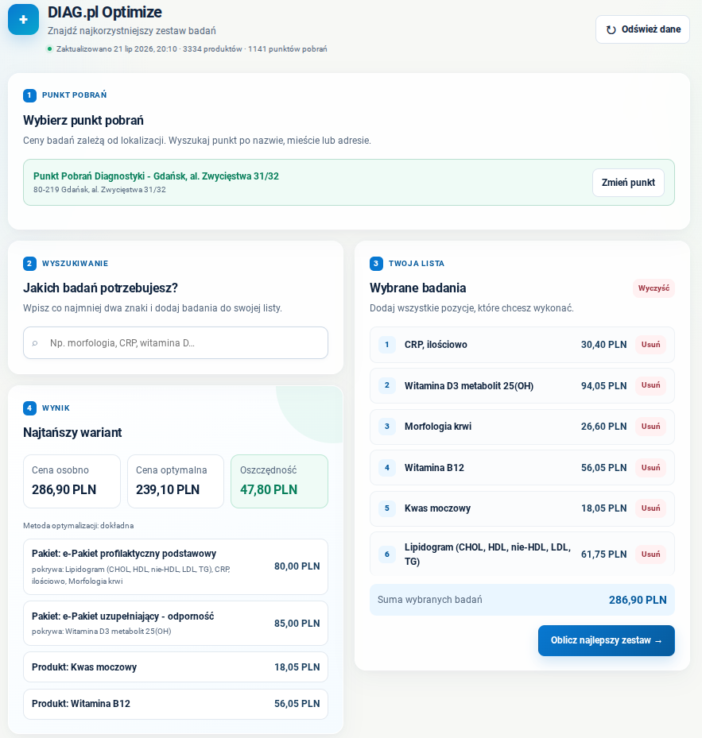

# DIAG.pl Optimize

Lokalna aplikacja w Pythonie, która pomaga znaleźć najtańszą kombinację pojedynczych badań i pakietów dostępnych w sklepie DIAG.pl.

Projekt pobiera aktualny katalog i ceny dla wybranego punktu pobrań, zapisuje je lokalnie w SQLite, a następnie rozwiązuje problem doboru najtańszego zestawu. Udostępnia prosty interfejs WWW oraz polski interfejs wiersza poleceń.

> [!IMPORTANT]
> To nieoficjalny projekt, niezwiązany z Diagnostyką S.A. Wyniki mają charakter informacyjny. Przed zakupem sprawdź aktualną cenę, dostępność, zakres pakietu i warunki badania bezpośrednio w serwisie [DIAG.pl](https://diag.pl/).

## Interfejs webowy



## Możliwości

- wybór punktu pobrań po nazwie, mieście lub adresie,
- pobieranie aktualnych produktów, pakietów i cen z publicznego API DIAG.pl,
- wyszukiwanie badań w lokalnym katalogu,
- porównywanie zakupu badań osobno z dostępnymi pakietami,
- dokładna optymalizacja mniejszych list metodą programowania dynamicznego,
- opcjonalna optymalizacja ILP dla większych list,
- szybki tryb przybliżony, gdy dokładny solver nie jest dostępny,
- lokalna baza SQLite i brak obowiązkowych zależności zewnętrznych,
- polski interfejs WWW i CLI.

## Wymagania

- Python 3.10 lub nowszy,
- połączenie z internetem podczas inicjalizacji i odświeżania danych,
- nowoczesna przeglądarka dla interfejsu webowego.

Podstawowa aplikacja korzysta wyłącznie z biblioteki standardowej Pythona. Pakiety `numpy` i `scipy` są opcjonalne — umożliwiają dokładną optymalizację ILP dla list przekraczających domyślny limit 20 badań.

## Szybki start - interfejs webowy

```bash
git clone https://github.com/xraysight/diagpl-optimize.git
cd diagpl-optimize
python3 diagpl-optimize-gui.py
```

Przy pierwszym uruchomieniu aplikacja pobierze listę punktów pobrań i otworzy stronę:

```text
http://127.0.0.1:8765
```

Następnie:

1. wyszukaj i wybierz punkt pobrań,
2. poczekaj na pobranie katalogu i cen,
3. dodaj badania do listy,
4. wybierz „Oblicz najlepszy zestaw”.

Przydatne opcje:

```bash
python3 diagpl-optimize-gui.py --pomoc
python3 diagpl-optimize-gui.py --bez-przegladarki
python3 diagpl-optimize-gui.py --port 9000
python3 diagpl-optimize-gui.py --baza /ścieżka/do/bazy.sqlite
```

Serwer domyślnie nasłuchuje wyłącznie na `127.0.0.1`. Nie wystawiaj go publicznie - aplikacja nie ma uwierzytelniania i jest przeznaczona do użytku lokalnego.

## Użycie z wiersza poleceń

### 1. Inicjalizacja

```bash
python3 diagpl-optimize-cli.py inicjalizuj
```

### 2. Wybór punktu pobrań

```bash
python3 diagpl-optimize-cli.py lista-punktow --szukaj "Gdańsk"
```

Pierwsza kolumna wyniku zawiera identyfikator punktu potrzebny w następnym kroku.

### 3. Pobranie produktów i cen

```bash
python3 diagpl-optimize-cli.py pobierz --punkt 889
```

### 4. Optymalizacja listy badań

```bash
python3 diagpl-optimize-cli.py optymalizuj \
  "Hemoglobina glikowana (HbA1c)" \
  "Wskaźnik insulinooporności HOMA-IR"
```

Pozostałe komendy:

```bash
python3 diagpl-optimize-cli.py lista-badan
python3 diagpl-optimize-cli.py lista-pakietow
python3 diagpl-optimize-cli.py pakiet "Badania na nerki"
python3 diagpl-optimize-cli.py --pomoc
```

## Algorytmy optymalizacji

Tryb `automatyczny` wybiera metodę zależnie od rozmiaru wejścia:

1. do 20 badań - dokładne programowanie dynamiczne po maskach bitowych,
2. powyżej 20 badań - dokładny solver ILP, jeśli dostępne są `numpy` i `scipy`,
3. gdy solver ILP jest niedostępny - szybki algorytm zachłanny z ostrzeżeniem, że wynik jest przybliżony, i poleceniem instalacji dla Pythona używanego przez aplikację.

Metodę można wskazać jawnie:

```bash
python3 diagpl-optimize-cli.py optymalizuj --algorytm dokladny "OB" "CRP, ilościowo"
python3 diagpl-optimize-cli.py optymalizuj --algorytm ilp "OB" "CRP, ilościowo"
python3 diagpl-optimize-cli.py optymalizuj --algorytm zachlanny "OB" "CRP, ilościowo"
```

### Instalacja dokładnego solvera dla większych list

Aplikacja nie instaluje pakietów samodzielnie. Na Windows uruchom poniższe polecenia w PowerShellu, w katalogu projektu. Nie musisz aktywować środowiska wirtualnego:

```powershell
py -m venv .venv
.\.venv\Scripts\python.exe -m pip install --upgrade numpy scipy
.\.venv\Scripts\python.exe .\diagpl-optimize-gui.py
```

Na Linuxie i macOS:

```bash
python3 -m venv .venv
. .venv/bin/activate
python3 -m pip install --upgrade numpy scipy
python3 diagpl-optimize-gui.py
```

## Dane lokalne

Aplikacja tworzy obok skryptów plik `diagpl-products.sqlite`. Może również generować snapshoty `diagpl-products-*.json`. Pliki te są ignorowane przez Git, ponieważ zawierają dane pobrane w konkretnym momencie i można je odtworzyć z poziomu aplikacji.

Aby użyć innej lokalizacji bazy, podaj `--baza PLIK`.

## Testy

Projekt używa modułu `unittest` z biblioteki standardowej:

```bash
python3 -m unittest discover -s tests -v
```

Sprawdzenie składni wszystkich modułów:

```bash
python3 -m py_compile \
  diagpl_optimize_core.py \
  diagpl-optimize-cli.py \
  diagpl-optimize-gui.py \
  tests/*.py
```

Te same testy są uruchamiane automatycznie przez GitHub Actions dla wspieranych wersji Pythona.

## Struktura projektu

```text
diagpl-optimize-cli.py   cienki punkt wejścia CLI
diagpl-optimize-gui.py   lokalny serwer WWW i interfejs użytkownika
diagpl_optimize_core.py  API, SQLite i algorytmy optymalizacji
tests/                   testy automatyczne
diagpl-optimize-PRD.md   szczegółowe wymagania produktu
```

## Ograniczenia

- ceny i dostępność zależą od punktu pobrań oraz chwili pobrania danych,
- dopasowanie badań opiera się na nazwie, skrócie adresu produktu i kodzie eLab,
- tryb zachłanny nie gwarantuje globalnie najtańszego wyniku,
- aplikacja nie uwzględnia indywidualnych kodów rabatowych ani wszystkich warunków handlowych,
- działanie zależy od niegwarantowanego, publicznego API używanego przez sklep DIAG.pl.

## Współtworzenie

Projekt powstał w dużej mierze jako vibe coding. Zgłoszenia błędów i propozycje zmian są mile widziane. Przed wysłaniem pull requesta przeczytaj [CONTRIBUTING.md](CONTRIBUTING.md) i uruchom pełny zestaw testów.

## Licencja

Kod projektu jest udostępniany na warunkach licencji [MIT](LICENSE).
